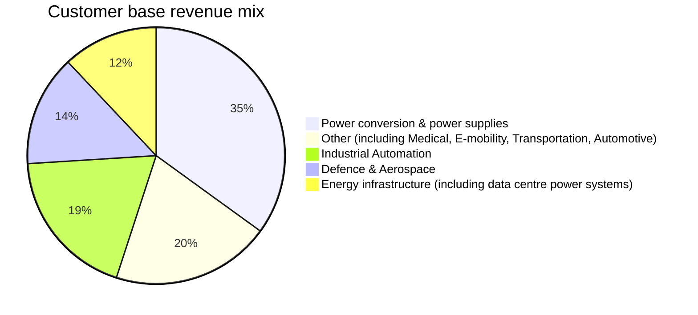

https://investors.incapcorp.com/shareholders/
https://eulerpool.com/stock/Incap-Oyj-Stock-FI0009006407
https://app.koyfin.com/chart-template/3adf19db-e75e-43a0-81a0-e39c71ea1a70/eq-6obv6e
https://www.inderes.se/en/companies/Incap
https://research.nordea.com/Company/Display/11578

## Diversified customer base Incap's Capital Markets Day 2026

| Segment | Share |
|---|---:|
| Power conversion & power supplies | 35% |
| Other | 20% |
| Industrial Automation | 19% |
| Defence & Aerospace | 14% |
| Energy infrastructure | 12% |

*Snapshot based on Q1-Q3 2026 revenue figures. Incap does not currently report segment information.*